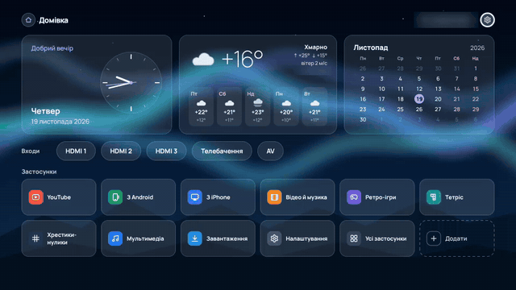
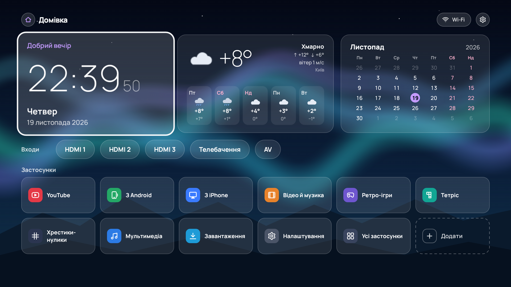
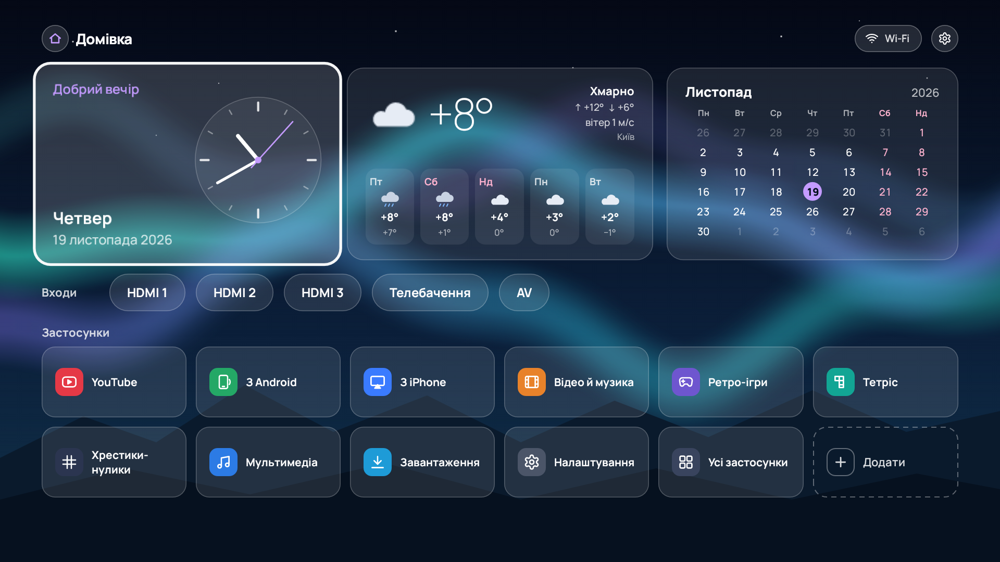
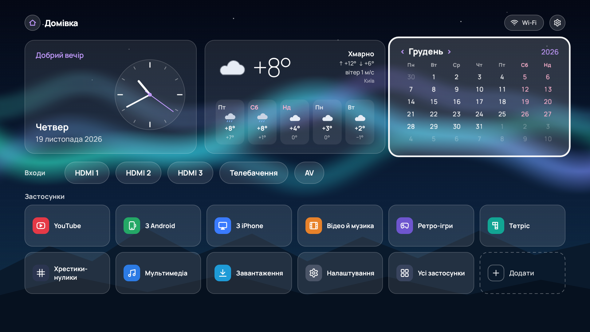
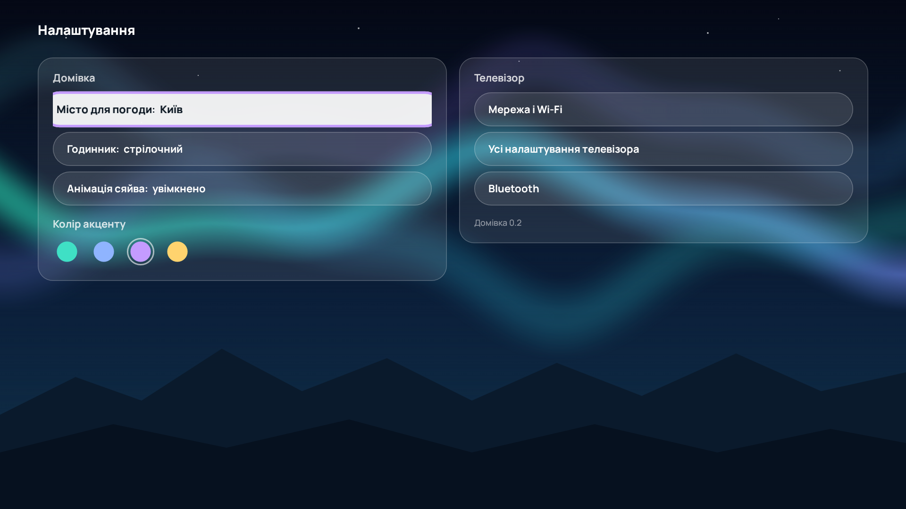

# Домівка · Domivka TV

A glass-and-aurora home screen for cheap Android TVs, plus a phone remote (status widget, power, volume, screen-mirroring button).
Built for a real 32″ TD Systems K32DLX9HS (Android 7, ~800 MB RAM, Mali-450) — so it is light: **~320 KB APK, ~18 MB RAM**.

> 🇺🇦 Інтерфейс українською. Зроблено для старого телевізора, де рідний лаунчер лагав.

<p align="center"></p>

<p align="center"><a href="media/demo.mp4">▶ Full 70-second demo (MP4, 30 fps)</a></p>

| Clock · digital | Clock · analog |
|---|---|
|  |  |
| **Calendar (OK, then ◀ ▶ to flip months)** | **Settings** |
|  |  |

> Recorded on the real TV with its built-in recorder, which tops out at ~16 fps on this chip; the video was frame-interpolated to 30 fps. On the TV itself the aurora runs at a steady 30 fps.


## What is in this repo

| Folder | What | 
|---|---|
| [`launcher/`](launcher) | **Домівка** — the TV launcher: animated northern-lights background, clock (digital / digital with seconds / analog), weather (Open-Meteo, no API key), month calendar, HDMI/TV/AV input buttons, app tiles you can replace, all-apps screen, on-screen city search. Made for the D-pad: everything is reachable with a remote. |
| [`remote/`](remote) | **Пульт Домівки** — an Android *phone* app: a home-screen widget with the TV status (on / off) and a power button, and an on-screen remote (D-pad, OK, Back, Home, volume, power, and a "cast my screen" button). Keys are fast (~0.1–0.3 s): they are written straight into the TV's IR-remote input device over one kept ADB connection instead of starting `input keyevent` (~2 s on this CPU). Talks to the TV over ADB-over-Wi-Fi. |

It is a **launcher (an ordinary app), not firmware** — nothing on the TV is flashed; you can switch back to the stock launcher at any time.

## Why it is fast on a weak GPU

* No live blur. The "glass" is a 9 % white fill over an aurora that is already soft, so it reads as glass for free.
* The aurora is a few pre-rendered, blurred ribbon bitmaps moved with sine-driven matrices — paced on even vsync for a steady 30 fps (falls back to 20).
* Calendar and clock draw straight on a canvas; one `View` instead of dozens.

## Install the launcher

1. Enable developer options and **ADB debugging** on the TV (or sideload with a USB stick).
2. `adb connect <tv-ip>:5555`
3. Installing a streamed APK can fail on some vendor builds ("digest did not verify"), so push first:
   ```bash
   adb push launcher-release.apk /data/local/tmp/domivka.apk
   adb shell pm install -r /data/local/tmp/domivka.apk
   adb shell cmd package set-home-activity com.domivka.launcher/.MainActivity
   ```
   Re-run the last line after installing or removing any other launcher — Android resets the default.
4. Build from source: `cd launcher && ./gradlew assembleRelease` (JDK 17, Android SDK 35). The release build is signed with the debug key so it can be sideloaded as-is.

## About HDMI inputs

On this TV the stock launcher switches inputs through a vendor service (CVTE `com.cvte.tv.api`). `CvteInputSwitcher` calls it through reflection and **falls back to the stock launcher's input row** if the service is missing — so the launcher still runs on any Android TV, but the HDMI buttons only work on CVTE-based sets. To support another vendor, implement `InputSwitcher` (7 lines).

## The phone remote

* Build: `cd remote && ./gradlew assembleRelease`, install the APK on your phone, add the **Пульт Домівки** widget.
* The TV is found by scanning your Wi-Fi network for an open ADB port; no IP or MAC address is stored in the code. The MAC addresses are read from the TV while it is on and used for Wake-on-LAN.
* This TV's adbd serves **one ADB client at a time**: while the phone remote is open, a computer's `adb` cannot connect, and vice versa. The remote frees the slot when it is hidden.
* Power-on from standby only works if the TV keeps listening to the network while off (many do not).

### ⚠️ Security note
The remote needs **ADB over TCP without authentication** (`ro.adb.secure=0`, as on this TV). Anyone on the same Wi-Fi can control such a TV. Use it only on a network you trust.

## Settings (on the TV)

Gear icon → city search (own on-screen keyboard, works with a D-pad), shimmer on/off, accent colour.
Weather card → OK opens the city search. Clock → OK cycles the face. Calendar → OK, then ◀ ▶ to flip months.
Tile → Menu key (or long-press OK) → replace / remove.

## Licence

[MIT](LICENSE). Third-party components: see [NOTICE.md](NOTICE.md).

---

## 🇺🇦 Коротко українською

**Домівка** — головний екран (лаунчер) для недорогих Android-телевізорів: північне сяйво, скляні картки, годинник (цифровий / із секундами / стрілочний), погода, календар, входи HDMI, плитки застосунків. Весь інтерфейс — українською, керується пультом.
**Пульт Домівки** — застосунок для телефона: віджет «Увімкнений / Вимкнений» з кнопкою живлення та екранний пульт.

Це **не прошивка**: телевізор не перепрошивається, у будь-який момент можна повернути рідний лаунчер.
